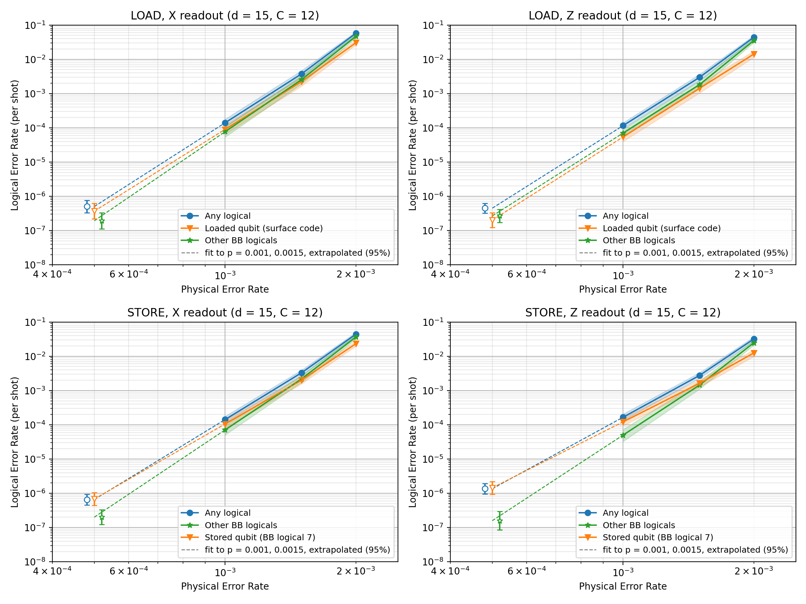
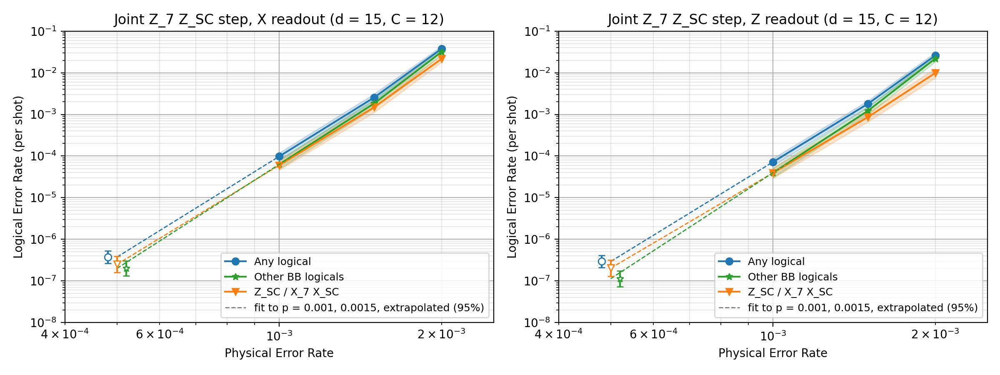

# qLDST

`mtxir` compiles LOAD/STORE programs between a bivariate bicycle (BB)
memory, such as the gross code [[144,12,12]], and surface-code patches.
It turns them into Stim circuits with circuit-level noise, detectors and
observables.

A qubit moves by teleportation: two logical measurements, each done by
gauging [WY24]. Those measurements temporarily deform the codes.

## Installation

```bash
pip install -e .            # or: uv pip install -e .
pip install -e ".[test]"    # with pytest
```

Requires Python ≥ 3.10. Dependencies: numpy, galois, networkx, stim,
sympy, bposd.

## Quick start

```python
from mtxir import (BivariateBicycleCode, SurfaceCode, CodeBlock,
                   Instruction, MtxIRCompiler, CircuitCompiler)

memory = CodeBlock(BivariateBicycleCode.generate_code(12))   # gross code
surface = CodeBlock(SurfaceCode(5))

ir = MtxIRCompiler(initial_memory_code_blocks=[memory],
                   initial_surface_code_blocks=[surface],
                   memory_basis="Z")
ir.initialize("q0", True, 0, 6)          # q0 starts in logical 6 of MEM[0]
ir.compile([
    Instruction(1, "LOAD", "q0", "SC[0]"),
    Instruction(4, "STORE", "q0", "MEM[0][6]"),
])

circuit = CircuitCompiler([memory], [surface], rounds_per_step=12,
                          aux_basis=ir.aux_basis, memory_basis="Z",
                          readout_basis="Z", p=1e-3).compile(ir.MtxIRs)
dem = circuit.detector_error_model()     # ready for a decoder or sinter
```

[examples/circuit.py](examples/circuit.py) runs two LOADs in parallel
from two memory blocks, then stores one of the qubits back.

## How it works

Compilation has two stages:

1. **`MtxIRCompiler`** ([src/mtxir/ir.py](src/mtxir/ir.py)) turns a list
   of `Instruction`s into a list of `MtxIRLayer`s, one per time step. A
   layer is the set of checks measured during that step.
2. **`CircuitCompiler`** ([src/mtxir/compiler.py](src/mtxir/compiler.py))
   schedules each layer's checks and adds noise. It also builds detectors
   between rounds and between layers, and observables from the final
   transversal readout.

### Instructions

The syntax is `Instruction(time, op, qubit, destination)`:

| Op | Destination | Effect |
|---|---|---|
| `LOAD` | `SC[i]` | teleport `qubit` from its memory slot into surface patch `i` |
| `STORE` | `MEM[i][j]` | teleport `qubit` from its surface patch into slot `j` (from 0) of memory block `i` |

Each op occupies `MemoryInstruction.<op>.time_steps` time steps (3 for both).
Instructions at the same time step run in parallel. `compile` rejects
programs in which a qubit or destination is used by two instructions at
once.

### The teleport

Let B be the basis of the destination's empty state: B = X for a fresh
surface patch, which starts in \|+⟩. Let J be the other basis. A teleport
starting at time step t runs three layers:

| Step | Layer | Rounds |
|---|---|---|
| t | gauging measurement of J_source · J_dest, outcome m | C |
| t + 1 | gauging measurement of B_source, outcome s | C |
| t + 2 | original codes; the edge qubits of both gaugings have been read out | 1 |

- **Pauli frame:** the destination then holds the source state up to
  Paulis set by s and m, plus a correction for the destination's sign if
  its empty state was a −1 eigenstate. These corrections are recorded in
  `MtxIRCompiler.pauli_frame`.
- **Source slot:** it is left empty, in a B eigenstate. A later STORE
  into that slot uses that sign.
- **Where the joint graph is built:** always on the memory block, with the
  surface-code logical attached to it. Building it on the surface-code
  side would make the BB checks much heavier (up to weight 17 at d = 15,
  against 7).

### Layers: `hx`/`hz` against `sx`/`sz`

- **CSS form:** original codes are built from CSS matrices `hx` and `hz`.
- **Symplectic form:** deformed layers mix Paulis within a check, for
  example a BB X check times Z on edge qubits. These layers are stored in
  symplectic form: row i of `sx`/`sz` is the check X^sx[i] Z^sz[i].
- **What the compiler reads:** `CircuitCompiler` reads only `sx`/`sz`.
- **Columns:** auxiliary columns are only ever appended. An edge column
  is read out in its initial basis after the last layer that uses it.

### Distance

With the gross code and a d = 15 surface code, every layer of a LOAD
followed by a STORE has X and Z distance ≤ 12. This is an upper bound
from a randomized search for the lowest-weight logical operator. The
limit is set by the gross code. The gauging layers do not lower it, and
the surface code is never the weakest part.

## Results

Logical error rate per shot for the gross code with a d = 15 surface code,
C = 12 rounds per gauging step, under circuit-level noise. Decoding uses a
sliding window of C rounds committing C/2, with Relay-BP and a BP-OSD-E
order-10 fallback.



The joint measurement alone, without the rest of the teleport:



How to read the plots:
- **Curves:** "Any logical" counts a shot as failed if any logical failed.
  The other two curves split that into the moved qubit and the remaining
  BB logicals.
- **Filled markers:** measured, with Sinter's band of rates within a factor
  of 1000 of the maximum-likelihood rate.
- **Open markers at p = 5e-4:** predictions, not measurements. They come
  from a power-law fit to p = 1e-3 and 1.5e-3, with 95% error bars. The
  markers are nudged apart in p so that the bars do not overlap.
- **p = 2e-3:** left out of the fit, because the decoder falls back on
  13–19% of shots there.

| Experiment | Readout | Any logical, p = 1e-3 | Failures / shots | Predicted at p = 5e-4 (95%) |
|---|---|---|---|---|
| LOAD | Z | 1.16e-4 | 358 / 3,089,850 | 4.5e-7 [3.2e-7, 6.3e-7] |
| LOAD | X | 1.40e-4 | 216 / 1,541,700 | 5.1e-7 [3.3e-7, 7.6e-7] |
| STORE | Z | 1.66e-4 | 289 / 1,740,350 | 1.4e-6 [9.5e-7, 1.9e-6] |
| STORE | X | 1.42e-4 | 275 / 1,933,000 | 6.6e-7 [4.6e-7, 9.4e-7] |
| Joint measurement | Z | 7.2e-5 | 330 / 4,576,950 | 3.0e-7 [2.1e-7, 4.1e-7] |
| Joint measurement | X | 9.8e-5 | 346 / 3,521,750 | 3.8e-7 [2.7e-7, 5.3e-7] |

Fitted slopes are 6.4–8.6, against (12 + 1)/2 = 6.5 for distance 12.

**Limitations of this data:**
- It comes from the earlier 4-step teleport, with one extra round of the
  original codes between the two gaugings. The current 3-step protocol has
  not been simulated at d = 15.
- The LOAD top-up run is incomplete: 43,270 of 69,033 jobs are included.
- The p = 5e-4 predictions assume the power law holds below the fitted
  range. Only about 1M shots were measured there, with 0–1 failures per
  point.

To regenerate the plots, run `python plot_ler_vs_p.py`. It reads the
`results/` folders of the CHTC runs, which live next to the package.

## Tests

```bash
python -m pytest
```

The tests check that:
- noisy circuits have deterministic detectors and observables;
- noiseless circuits produce no detection events;
- a logical flip at the start flips the final logical, through chains of
  LOAD and STORE;
- invalid instructions and occupied slots are rejected.


## References

- [WY24] D. J. Williamson and T. J. Yoder, *Low-overhead fault-tolerant
  quantum computation by gauging logical operators* (2024).
- S. Bravyi et al., *High-threshold and low-overhead fault-tolerant quantum
  memory*, Nature 627, 778 (2024).
